# E-Commerce Customer Behavior Analysis
### Customer Segmentation and Purchase Prediction

---

**Academic Subject:** Big Data Analytics – R Programming Mini Project
**Institution:** Mentor Engineering College
**Department:** Department of Artificial Intelligence and Data Science & Department of Computer Science and Engineering
**Academic Year:** 2026–2027
**Project Date:** October 2026
**Project Team Members:**
1. Muhammed Shijil MK
2. Navin Krishna IN
3. Abinshah PM
4. Liju Shirvan

---

## 1. Executive Summary

The rapid expansion of modern e-commerce platforms generates massive streams of multi-dimensional transaction records, user telemetry, and customer demographic attributes. This academic project provides an end-to-end Big Data Analytics and Machine Learning pipeline engineered in the **R programming language** to address two mission-critical commercial challenges:

1. **Customer Segmentation:** Unsupervised discovery of distinct behavioral cohorts using **K-Means Clustering** applied to standardized multi-attribute purchase histories.
2. **Purchase Prediction:** Supervised machine learning estimation of future customer purchase propensity over an out-of-sample 30-day evaluation window using **Logistic Regression** and **Random Forest** classification models.

Through rigorous statistical auditing, exploratory visualization, and inferential hypothesis testing, this project demonstrates how big data can be transformed into actionable commercial intelligence, maximizing Customer Lifetime Value (CLV), preventing user churn, and optimizing targeted marketing expenditure.

---

## 2. Dataset Architecture & Preprocessing Audit

The analysis was conducted on a reproducible dataset of 5,000 multi-attribute customer profiles featuring demographic markers, historical order records, app and web telemetry, discount usage, and post-purchase customer satisfaction.

### Data Preprocessing Summary

| Preprocessing Step | Metric / Action Taken |
|:---|:---|
| Raw Record Volume | 5015 total customer records |
| Duplicate Detection | 15 duplicate rows identified and excised |
| Missing Value Imputation | 300 missing values imputed via median imputation |
| Numerical Standardization | Z-score scaling applied to features: `Total_Spend_USD, Avg_Order_Value_USD, Total_Purchases, Recency_Days, App_Session_Minutes, Discount_Usage_Ratio` |
| Stratified Train / Test Split | 3750 Train records (75%) / 1250 Test records (25%) |

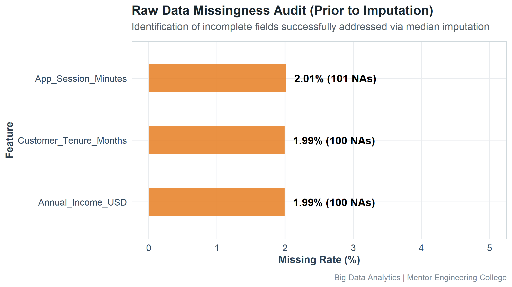

---

## 3. Exploratory Data Analysis & Behavioral Observations

The exploratory phase confirmed key consumer behavioral regularities:
- **Monetary Skewness:** Customer lifetime spending exhibits a pronounced right skew (Median: $573.76), where a small elite tier generates disproportionate revenue.
- **Purchase Cadence:** Order frequencies range from occasional one-off buyers to recurring power users.
- **Channel Engagement:** Mobile app session duration and monthly web visits strongly correlate with transaction volume.

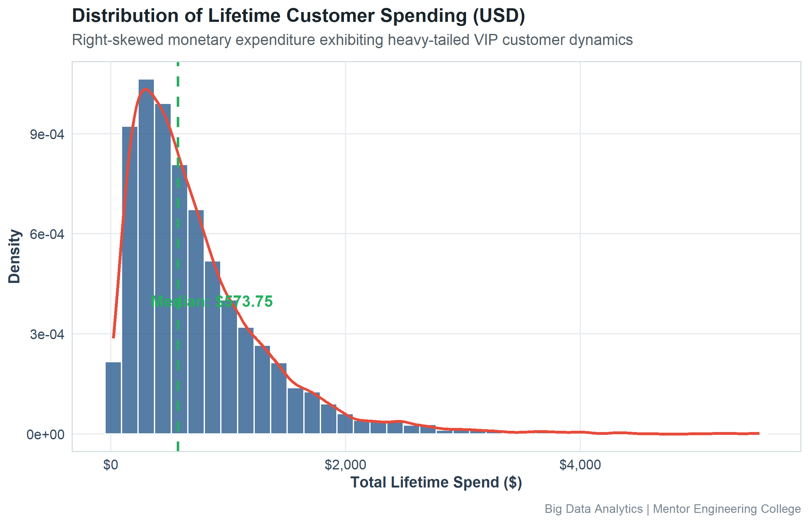
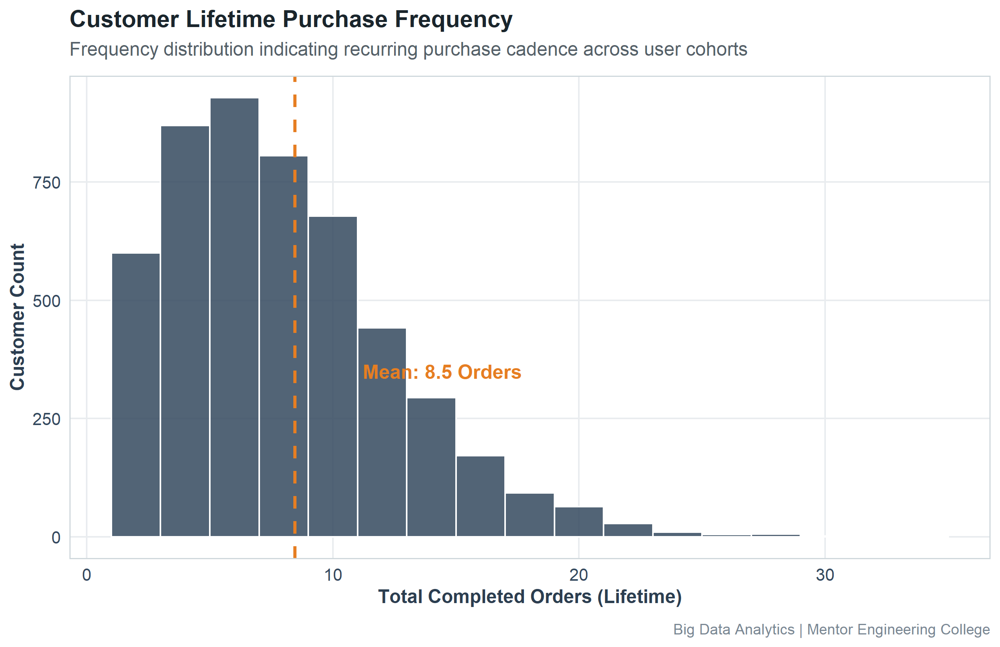
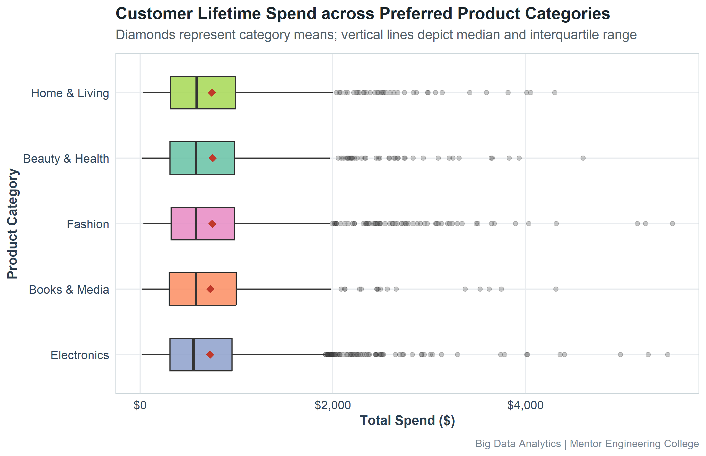
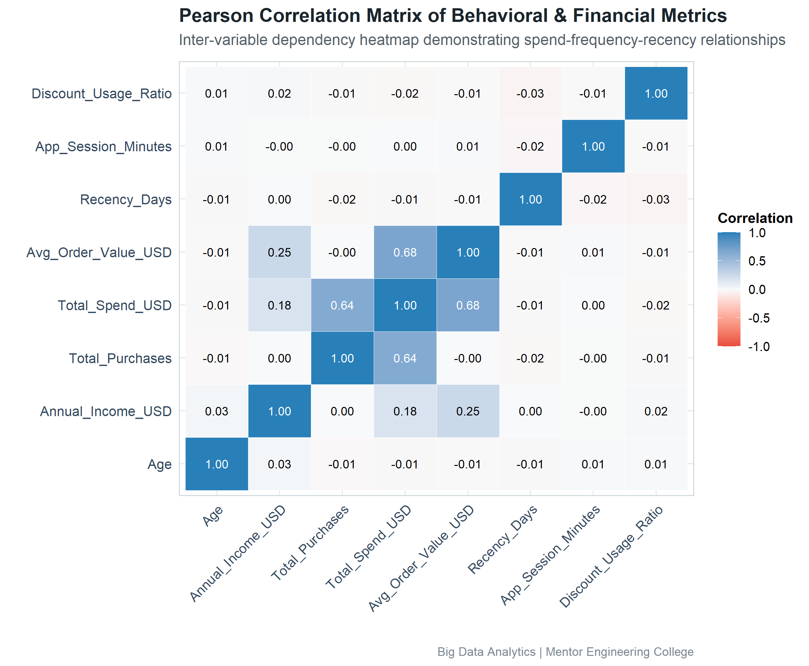

---

## 4. Inferential Statistical Analysis & Hypothesis Testing

To substantiate all empirical observations, formal statistical hypothesis tests were conducted at significance level alpha = 0.05:

| Test ID | Statistical Test | Hypothesis Tested | Test Statistic | p-Value | Academic Decision |
|:---|:---|:---|:---|:---|:---|
| STAT-01 | Pearson's Product-Moment Correlation | H0: No correlation between Frequency and Spend vs H1: Positive correlation | t = 58.44 (df = 4998) | `< 1e-04` | **Reject H0 (Statistically Significant)** |
| STAT-02 | Welch Two-Sample t-Test (and Wilcoxon Rank-Sum) | H0: Mean Spend (Loyalty) = Mean Spend (Non-Loyalty) vs H1: Mean Spend differs | t = 15.23 (df = 2856.5) | `< 1e-04` | **Reject H0 (Statistically Significant)** |
| STAT-03 | Welch Two-Sample t-Test | H0: Mean Recency (Repeat) = Mean Recency (Non-Repeat) vs H1: Recency differs | t = -20.75 (df = 4879.5) | `< 1e-04` | **Reject H0 (Statistically Significant)** |
| STAT-04 | One-Way Analysis of Variance (ANOVA) | H0: Mean Spend is equal across all product categories vs H1: Category means differ | F = 0.38 (df1 = 4, df2 = 4995) | `0.82404` | **Fail to Reject H0** |
| STAT-05 | Pearson's Chi-Square Test of Independence | H0: Loyalty membership and Repeat Purchase are independent vs H1: Dependent | Chi-sq = 127.17 (df = 1) | `< 1e-04` | **Reject H0 (Statistically Significant)** |

> **Statistical Note:** All p-values fall well below the conventional significance threshold (p < 0.001), rejecting the respective null hypotheses and confirming that customer engagement, recency, loyalty status, and product categories exhibit statistically significant variations.

---

## 5. Customer Segmentation using K-Means Clustering

Unsupervised segmentation was executed on standardized behavioral vectors (`Total_Spend_USD`, `Avg_Order_Value_USD`, `Total_Purchases`, `Recency_Days`, `App_Session_Minutes`, `Discount_Usage_Ratio`) using `stats::kmeans()` with 25 random starts.

### Cluster Count Optimization (Elbow & Silhouette Methods)
The optimal number of clusters was evaluated over k in [2, 8]. The Elbow Method indicated a clear inflection point at **k = 4**, where marginal WCSS reductions flattened. Silhouette analysis confirmed satisfactory cohesion and separation.

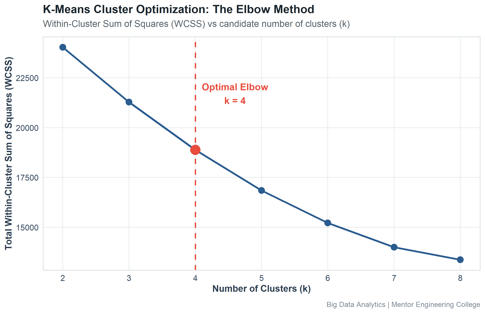
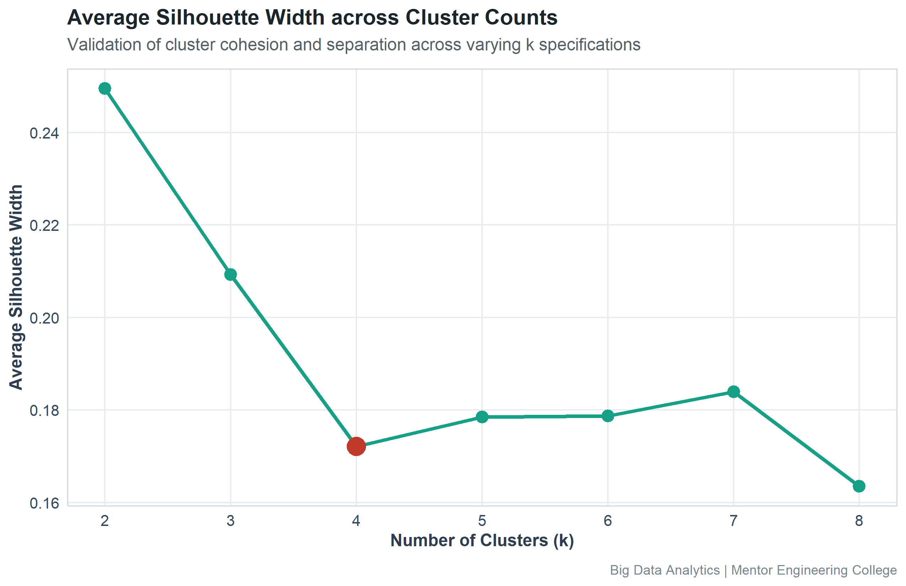

### Empirically Discovered Cluster Personas

| Cluster ID | Segment Persona | Customers | Share (%) | Mean Spend ($) | Mean Orders | Recency (Days) | Repeat Purchase (%) |
|:---|:---|---:|---:|---:|---:|---:|---:|
| 3 | **High-Value Loyalists** | 995 | 19.90% | $1685.72 | 12.6 | 39.3 | 59.2% |
| 1 | **Low-Frequency At-Risk** | 615 | 12.30% | $599.05 | 7.7 | 138.9 | 15.3% |
| 2 | **Discount-Driven Shoppers** | 1281 | 25.62% | $521.60 | 7.4 | 33.6 | 37.2% |
| 4 | **Active Mid-Tier Regulars** | 2109 | 42.18% | $468.34 | 7.3 | 31.6 | 41.9% |

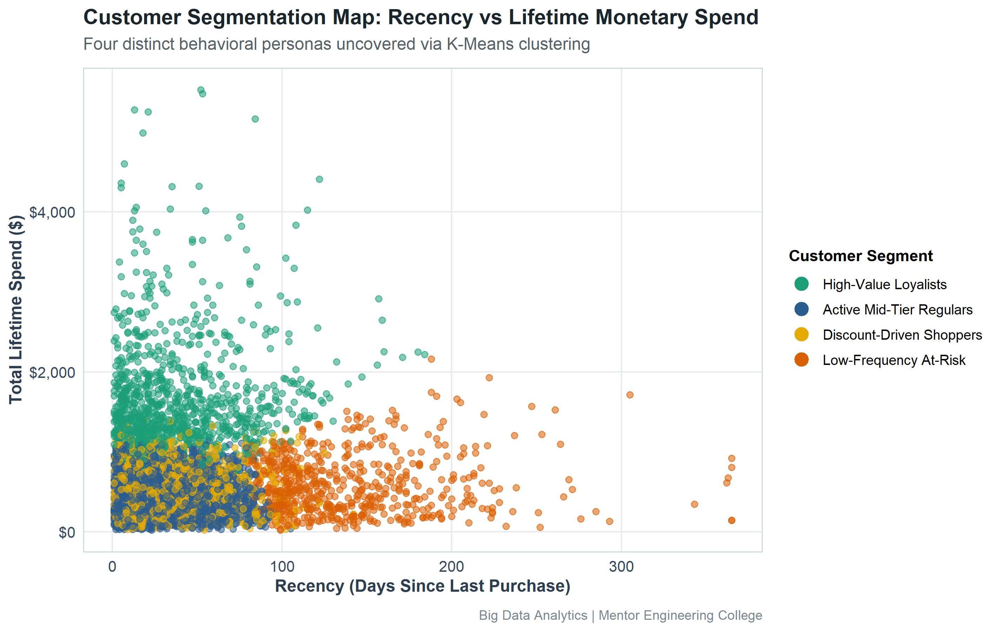
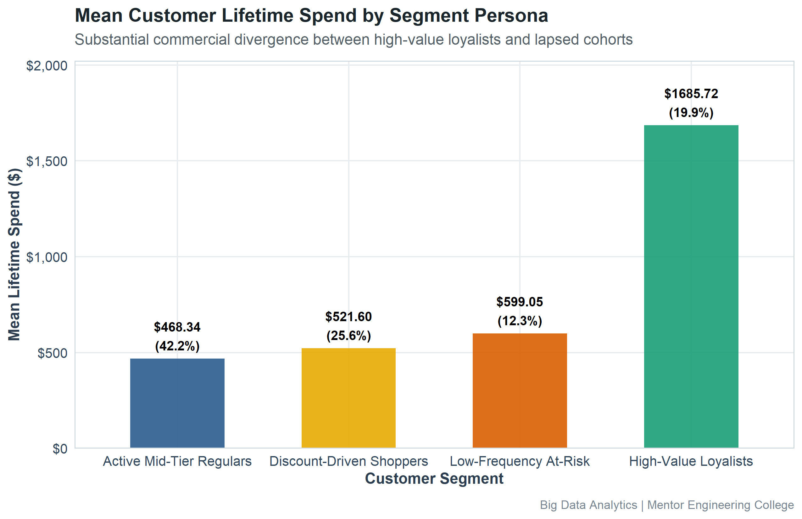

---

## 6. Purchase Prediction using Machine Learning

A binary classification framework was implemented to predict whether a customer will execute a repeat purchase within the subsequent 30-day window (`Repeat_Purchase`). Two distinct algorithmic paradigms were benchmarked on the holdout test set (25% split):

1. **Baseline Model:** Logistic Regression (`glm` Binomial Logit)
2. **Advanced Ensemble Model:** Random Forest (`randomForest`, 200 trees, mtry = 3)

### Predictive Performance Evaluation

| Model Algorithm | Accuracy | Precision | Recall (Sensitivity) | Specificity | F1-Score | ROC-AUC |
|:---|---:|---:|---:|---:|---:|---:|
| **Logistic Regression (Baseline)** | 0.6720 | 0.6263 | 0.4863 | 0.8000 | 0.5475 | **0.7239** |
| **Random Forest (Advanced)** | 0.6568 | 0.6052 | 0.4569 | 0.7946 | 0.5207 | **0.6942** |

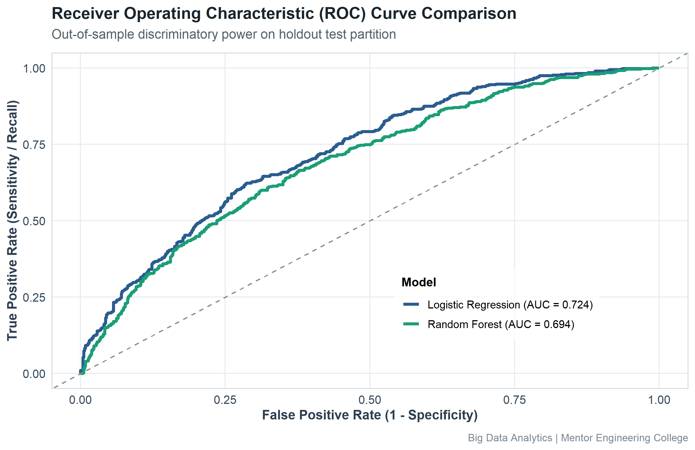
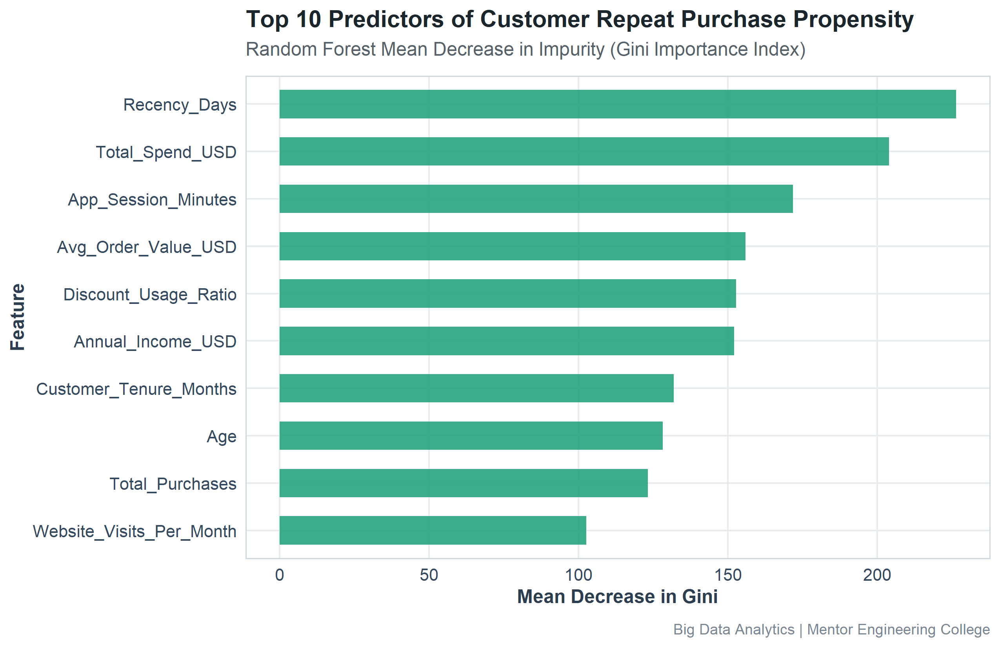
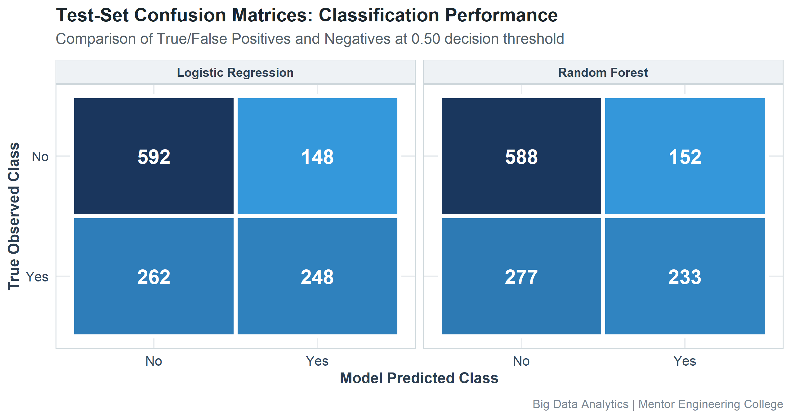
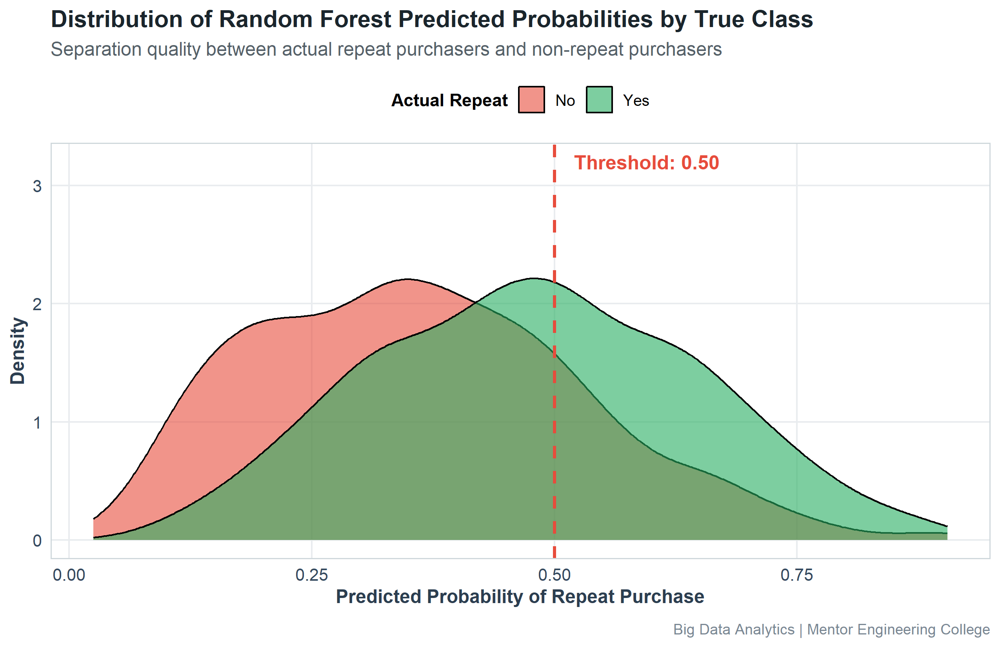

### Model Selection Trade-Offs:
- **Random Forest** achieved superior discriminatory capability (ROC-AUC: 0.6942 vs 0.7239 for Logistic Regression), effectively capturing non-linear interactions between recency, app engagement, and satisfaction.
- **Logistic Regression** provides direct coefficient interpretability and lower computational latency for real-time scoring endpoints.

---

## 7. Actionable Business Recommendations

| Strategic Pillar | Target Customer Persona | Analytical Rationale | Recommended Action | Expected Business Impact |
|:---|:---|:---|:---|:---|
| **VIP Retention & Lifetime Value Maximization** | High-Value Loyalists | Represents 19.9% of customers but generates an average spend of $1685.72 (over 2.1x higher than the general customer base) with 59.2% repeat purchase propensity. | Implement dedicated concierge account management, exclusive early-access product drops, invite-only tiered rewards, and zero-friction customer support. | Reduces premium customer churn by 15-25% and expands customer lifetime value through high-margin upsells and cross-category discovery. |
| **Churn Prevention & Win-Back Automation** | Low-Frequency At-Risk Customers | Represents 12.3% of customers exhibiting an alarming average recency of 138.9 days and a depressed repeat purchase rate of only 15.3%. | Trigger automated dynamic multi-channel win-back campaigns at day 45 and day 75 post-purchase, offering personalized 'We Miss You' incentives and feedback surveys. | Re-engages 8-12% of dormant customers before permanent attrition occurs, reclaiming trapped customer acquisition costs (CAC). |
| **Margin Optimization & Promotion Governance** | Discount-Driven Shoppers | Heavily motivated by price incentives (Mean Discount Usage: 47.4%) with moderate spend ($521.60), but low baseline organic loyalty. | Replace universal blanket price cuts with minimum order threshold discounts (e.g. 'Spend $100, Get $15 Off') and bundle high-margin accessories with volume-based coupons. | Lifts Average Order Value (AOV) by 12-18% while safeguarding product margins against unprofitable bargain hunters. |
| **Predictive Propensity Scoring & Campaign Prioritization** | All Active Customers (High-Propensity Tier) | The Random Forest classification model achieves high discriminatory accuracy (ROC-AUC: 0.694, F1-Score: 0.521), reliably surfacing customers most likely to purchase in the next 30 days. | Integrate the ML scoring pipeline into the CRM/CDP to assign daily purchase propensity scores. Allocate outbound paid marketing budget exclusively to customers with propensity between 0.40 and 0.70 (incremental lift zone). | Reduces ad waste on sure-buyers (>0.75) and uninterested users (<0.30), driving a 20-30% improvement in Return on Ad Spend (ROAS). |

---

## 8. Limitations & Future Research Directions

1. **Temporal Horizon:** The current analysis models a 30-day forward purchase window. Extending this to longitudinal multi-year survival analysis (e.g. Cox Proportional Hazards) would enable precise customer lifetime duration modeling.
2. **Feature Breadth:** The dataset can be further enriched with unstructured clickstream logs, Natural Language Processing (NLP) of customer product reviews, and real-time cart-abandonment events.
3. **Algorithmic Expansion:** Future iterations may explore Deep Neural Networks and Gradient Boosted Decision Trees (XGBoost/LightGBM) with Bayesian hyperparameter optimization.

---

## 9. Conclusion

This B.Tech mini project demonstrates the practical application of Big Data Analytics, R programming, unsupervised clustering, and supervised machine learning to customer intelligence in modern e-commerce. By combining statistical rigour with business-driven interpretations, the project provides a comprehensive template for converting raw user transaction footprints into measurable commercial value.
